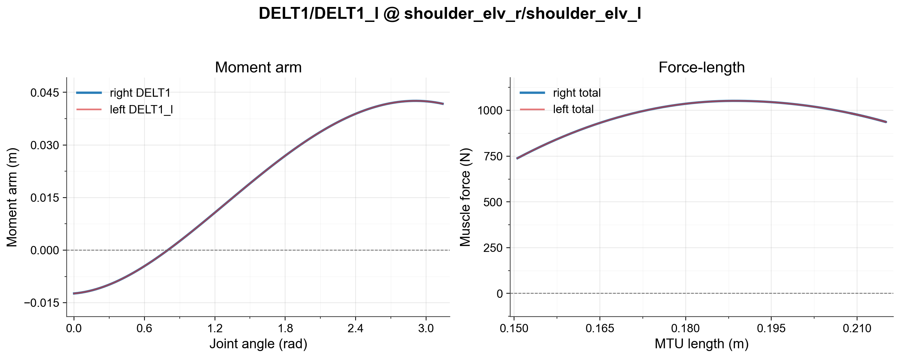

# MyoArm

MyoArm is a MuJoCo musculoskeletal model of the right upper extremity — shoulder girdle through hand — derived from the MoBL upper-extremity OpenSim model and the MyoHand model.

## Anatomical scope

| Property | Value |
|---|---|
| Degrees of freedom | 38 |
| Actuators (muscles) | 63 |
| Body segments | clavicle, scapula, humerus, radius, ulna, carpals (scaphoid, lunate, triquetrum, pisiform, trapezium, trapezoid, capitate, hamate), metacarpals (1–5), proximal/middle/distal phalanges (digits 2–5), thumb phalanges |
| Primary joints | shoulder (sternoclavicular, acromioclavicular, glenohumeral, scapulothoracic constraints), elbow flexion, forearm pronation/supination, wrist flexion/deviation, finger MCP/PIP/DIP (digits 2–5), thumb CMC/MCP/IP |

## Reference model

- **Source:** [MoBL Upper Extremity Dynamic Model](https://simtk.org/projects/upexdyn/)
- **Paper:** Holzbaur et al., 2005 ([DOI](https://doi.org/10.1007/s10439-005-3320-7))

## Fidelity

<!-- TODO: review (quantitative fidelity claims; reproduce with the commands below) -->
Ten arm muscles use maps converted directly from MoBL-ARMS
([Holzbaur et al. 2005](https://doi.org/10.1007/s10439-005-3320-7);
`scripts/fit_arm_rigid_maps.py`, `status: adopted` in `myo_sim/build/references.py`).
The regression test (`tests/test_arm_rigid_conversion.py`) checks the published rigid-tendon fibre length.

Example fidelity check (DELT1 left/right moment-arm and force-length plot) for symmetry and muscle jumping for upper limb. The full bimanual arm muscle check can be run with `tests/debug_muscle_bimanual.py`.

## Known limitations

- [ ] No open arm-specific issues at this time — see [all open issues](https://github.com/MyoHub/myo_sim/issues)

## Manual adjustments

- Post-conversion adjustments to kinematic and dynamic behaviors to correct abnormal results from the automatic pipeline.
- Contact geometries manually designed with anatomical references; contact properties optimized for contact-rich behaviors.
- Muscle parameters updated during the 2026-05 refactor to improve force-length accuracy.

## Changelog

**2026-10-31** — Rigid-tendon maps of DELT2, DELT3, TMAJ, PECM3, LAT1, LAT2, LAT3, SUBSC, ANC and BRA derived directly from
MoBL-ARMS optimal fibre length, tendon slack length and pennation (`myo_sim/build/rigid_conversion.py --region arm`). Selected
by two checks decided beforehand: fibre length along the measured shoulder motions of Seth et al. (2019) for the muscles its model
tracks, and path agreement plus OpenSim fibre length and force for the others. The rotator cuff (scapular kinematics differ from
Seth's), TRIlong and the forearm/hand extrinsics keep their maps.

**2026-06-29** — Compared MyoArm-derived full-body geoms against the previous MuscleMimic full-body model. The old reference contained non-collision wrap geoms `APL_torus_wrap_left` on `hamate_l`, `FCU_wrap_left` on `pisiform_l`, and `Trpzm_wrap_left` on `trapezium_l`; these are intentionally absent from the current MyoArm XML as they were never used. Removed `distph2_r_coll_2` from the required parity list because it duplicated the unnamed ellipsoid already present on `distph2_r`.

**2026-06-05** — Moved chest ownership to myotorso; added unit tests.

**2026-06-03** — Refactored model structure and enhanced asset management.

**2026-05-27** — Added contact XML; refactored arm model structure and updated muscle parameters.

**2026-05-25** — Removed redundant left arm; left arm now mirrored via mjspec. Hands extracted from arms via mjspec.

**2023-12-26** — Initial XML release of myoarm models.

## Citation

See repository README.
