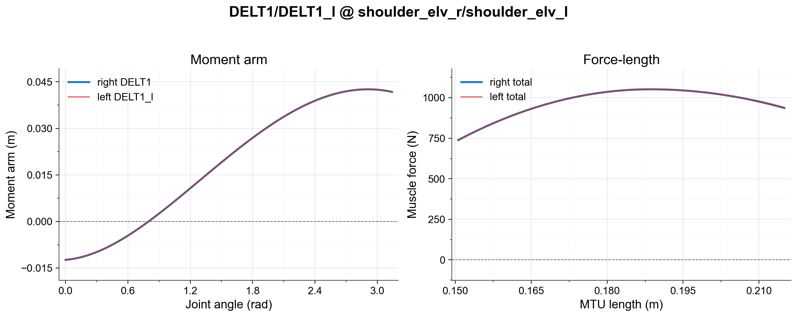

# MyoArm

MyoArm is a MuJoCo musculoskeletal model of the right upper extremity — shoulder girdle through hand — derived from the MoBL upper-extremity OpenSim model and the MyoHand model.

## Anatomical scope

| Property | Value |
|---|---|
| Degrees of freedom | 38 |
| Actuators (muscles) | 71 (63 + intrinsic AdPt, AdPo, FPBs, FPBd, APB, DI1s, FDM, ODM; RI2 is DI1d, UI_UB5 is ADM, and RI3-5 / LU_RB2-5 / UI_UB2-4 are DI2-4, PI1-3, LUM1-4) |
| Body segments | clavicle, scapula, humerus, radius, ulna, carpals (scaphoid, lunate, triquetrum, pisiform, trapezium, trapezoid, capitate, hamate), metacarpals (1–5), proximal/middle/distal phalanges (digits 2–5), thumb phalanges |
| Primary joints | shoulder (sternoclavicular, acromioclavicular, glenohumeral, scapulothoracic constraints), elbow flexion, forearm pronation/supination, wrist flexion/deviation, finger MCP/PIP/DIP (digits 2–5), CMC4/5 flexion (coupled), thumb CMC/MCP/IP; internal lumbrical and junctura node slides `node_LUM1-4_r`, `node_JT3-5_r` (tied by equalities, not controlled) |

## Reference model

- **Source:** [MoBL Upper Extremity Dynamic Model](https://simtk.org/projects/upexdyn/)
- **Paper:** Holzbaur et al., 2005 ([DOI](https://doi.org/10.1007/s10439-005-3320-7))

## Fidelity

Example fidelity check (DELT1 left/right moment-arm and force-length plot) for symmetry and muscle jumping for upper limb. The full bimanual arm muscle check can be run with `tests/debug_muscle_bimanual.py`.

## Known limitations

- [ ] No open arm-specific issues at this time — see [all open issues](https://github.com/MyoHub/myo_sim/issues)

## Manual adjustments

- Post-conversion adjustments to kinematic and dynamic behaviors to correct abnormal results from the automatic pipeline.
- Contact geometries manually designed with anatomical references; contact properties optimized for contact-rich behaviors.
- Muscle parameters updated during the 2026-05 refactor to improve force-length accuracy.

## Changelog

**2026-10-29** — Juncturae tendinum, FCU, FDS5: junction nodes on EDC3, EDC4 and EDC5 (slide joints `node_JT{3,4,5}_r` tied by tendon equalities, +3 joints/qpos and +3 equalities per hand) with tension-only links `lig_JT34_r`, `lig_JT45_r`; FCU over the pisiform and the hamate hook (`FCU-P5_r` new, the MC5 site renamed `FCU-P6_r`); FDS5 force 75.3 -> 46.5 N. See `docs/wiki/hand-extrinsic-muscles.md`.

**2026-10-29** — Lumbrical junction nodes: each lumbrical arises from a node on its FDP tendon (slide joint `node_LUM{1..4}_r` tied by a tendon equality to the FDP's distal length), +4 joints/qpos and +4 equalities per hand. See `docs/wiki/passive-moments-and-thenar.md`.

**2026-10-29** — Interossei and lumbricals by identity: `LU_RB2-5` -> `LUM1-4`, `UI_UB2` -> `PI1`, `RI3` -> `DI2`, `UI_UB3` -> `DI3`, `RI4` -> `PI2`, `UI_UB4` -> `DI4`, `RI5` -> `PI3` (same indices); Jacobson 1992 forces, hood fractions after Salsbury 1937, paths fitted to An 1979/1983. See `docs/wiki/passive-moments-and-thenar.md`.

**2026-10-29** — Finger extensor mechanism (option a): EDC2-5, EIP, EDM, LU_RB2-5 and UI_UB2-4 end on junction sites of the proximal phalanx and branch (MuJoCo pulleys) into central slip and lateral bands; oblique retinacular ligaments `lig_ORL{2..5}_r` (+4 tendons per hand). See `docs/wiki/extensor-mechanism.md`.

**2026-10-29** — Hypothenar muscles: `UI_UB5` re-routed as `ADM`, `FDM` and `ODM` added (+2 actuators per hand). See `docs/wiki/passive-moments-and-thenar.md`.

**2026-10-29** — Fourth and fifth carpometacarpal joints `cmc4_flexion_r` / `cmc5_flexion_r`, coupled CMC5 = 2.06 x CMC4, with end-range springs; five sites moved to the bone they belong to. See `docs/wiki/hand-cmc-joints.md`.

**2026-10-29** — Thumb and first-dorsal-interosseous heads: `AdP` -> `AdPt` + `AdPo`, `FPB` -> `FPBs` + `FPBd`, `RI2` -> `DI1d` + `DI1s`; OP, APB, FPB and DI1 sites fitted to published moment arms, thumb intrinsic passive scales and springs refitted (+3 actuators per hand). See `docs/wiki/passive-moments-and-thenar.md`.

**2026-10-29** — PIP flexion limit of digits 2-5 raised from 90 to 115 deg (Leijnse et al. 2010), palm pads refitted (palm 8.0 mm), EDM without the `Fifthpm_wrap_r` wrap. See `docs/wiki/passive-moments-and-thenar.md`.

**2026-10-29** — Fingertip pads moved from the nail side to the palm side and fitted to the fingertip soft tissue of Dallard et al. 2018; palm, thenar and hypothenar pads added; 144 self-contact pairs per hand (`contacts/myohand_self_contacts.xml`) now in every model with a hand. Changes the dynamics wherever fingers touch each other or the palm. See `docs/wiki/hand-contacts-and-pads.md`.

**2026-10-29** — Every right-arm joint, actuator, tendon, geom and camera name carries `_r` (`OP` -> `OP_r`, `cmc_flexion` -> `cmc_flexion_r`); muscle tendons are named after their actuator (`OP_r_tendon`, left `OP_l_tendon`); `plam_lookat` is `palm_lookat_r`. Names only: the compiled numerics are identical. See `CHANGELOG.md` for the downstream list.

**2026-10-28** — Passive force scale (`fpmax`) of EDC3, EDC4, EDC5 and EDM raised from 0.002 to 0.0525 so that digits 3-5 open when the wrist flexes (McFarland et al. 2023 release trial); slack lengths unchanged. This changes the passive forces, and so the dynamics, of every model with a hand. See `docs/wiki/passive-muscles-tenodesis.md`.

**2026-10-28** — Finger MCP, PIP and DIP damping set to Kamper et al. 2002 (0.0142, 0.0105, 0.0081 N m s/rad; was 0.05), and RI2 routed without the second-metacarpal wrap its insertion entered (its length jumped by 7 mm near 10 deg MCP flexion). Both change the dynamics of every model with a hand. See `docs/wiki/passive-moments-and-thenar.md`.

**2026-08-02** — Restored anatomical optimal fiber length (`L0`), tendon slack length (`LT`), and peak isometric force (`Fmax`) from the MoBL-ARMS reference for 7 of 8 inflated shoulder muscles (`TMIN`, `LAT2`, `INFSP`, `BICshort`, `TRIlong`, `SUPSP`, `PECM1`; `CORB` left unfixed pending a proper functional-ROM audit — its excursion/`L0` ratio matches the pattern that predicted a force-accuracy regression for 4 leg muscles) and all 24 inflated hand-extrinsic muscles (finger/wrist flexors and extensors), which had never received per-muscle calibration at all — every one compiled against MuJoCo's raw default `range="0.75 1.05"`. Also incidentally corrected a pre-existing `SUPSP` inconsistency where `gainprm` and `biasprm` held different values from each other. No arm/hand equivalent of the leg's gait-ROM force-accuracy cross-check exists yet, so these fixes are `L0`-matched-only, not independently force-validated the way the leg fixes are. Verified against `myoElbowPose1D6MRandom-v0` and `myoHandReachRandom-v0` in myosuite4 (random-action rollouts, no NaN/instability). See `docs/wiki/log.md` (2026-08-02 entries) for full detail.

**2026-06-29** — Compared MyoArm-derived full-body geoms against the previous MuscleMimic full-body model. The old reference contained non-collision wrap geoms `APL_torus_wrap_left` on `hamate_l`, `FCU_wrap_left` on `pisiform_l`, and `Trpzm_wrap_left` on `trapezium_l`; these are intentionally absent from the current MyoArm XML as they were never used. Removed `distph2_r_coll_2` from the required parity list because it duplicated the unnamed ellipsoid already present on `distph2_r`.

**2026-06-05** — Moved chest ownership to myotorso; added unit tests.

**2026-06-03** — Refactored model structure and enhanced asset management.

**2026-05-27** — Added contact XML; refactored arm model structure and updated muscle parameters.

**2026-05-25** — Removed redundant left arm; left arm now mirrored via mjspec. Hands extracted from arms via mjspec.

**2023-12-26** — Initial XML release of myoarm models.

## Citation

See repository README.
