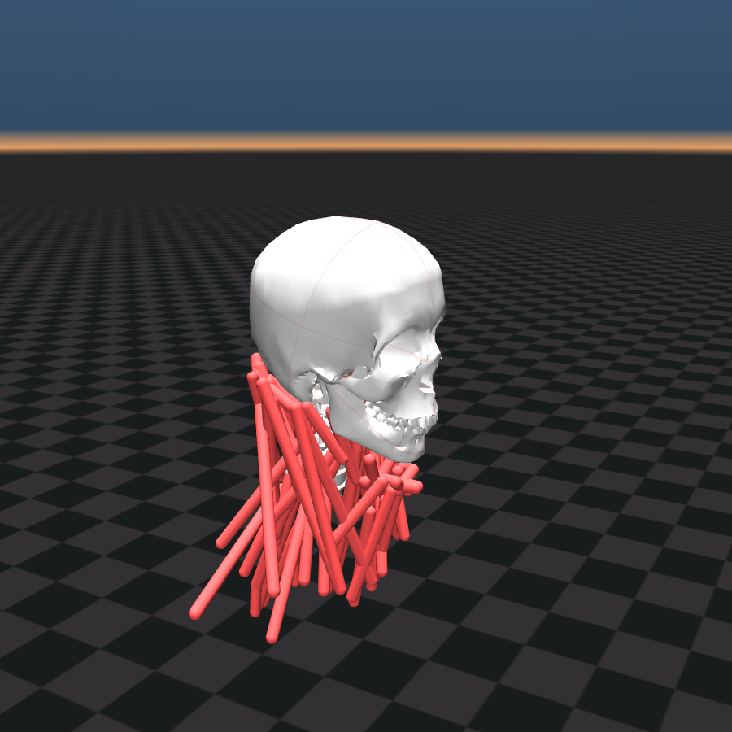
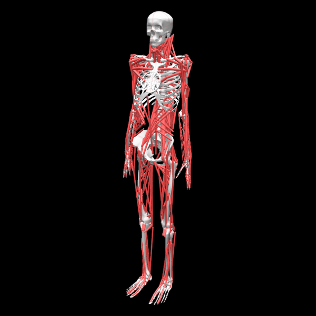

# MyoHead

Head-and-neck geometry from the existing HAT segment, with a muscular cervical chain derived from the scaled HYOID OpenSim model. The muscular neck is part of `myofullbody`; the part models, including `myotorso`, `myotorso_arms` and `myotorso_arm_r`, keep the rigid head.

| Muscular neck (`myohead`) | Full body with muscular neck (`myofullbody`) |
|---|---|
|  |  |

## Anatomical scope

| Property | Value |
|---|---|
| Degrees of freedom | Rigid scaffold: 0; `myohead`: 24 |
| Actuators (muscles) | Rigid scaffold: 0; `myohead`: 72 |
| Body segments | C7–C1 and skull, with welded jaw (part models: rigid neck/head) |
| Primary joints | myohead_pitch1, myohead_roll1, myohead_yaw1, myohead_pitch2, myohead_roll2, myohead_yaw2 |

Use `myo_sim.load("myohead")` for the fixed standalone neck. `myo_sim.load("myofullbody")`
has 147 joints and 488 actuators, including the neck's 24 joints and 72 actuators.
The neck actuators are the last 72 actuators; the neck joints follow the lumbar
joints, so arm and leg `qpos`/`qvel` indices move by 24. Controllers and
checkpoints trained on the former rigid-head model (123 joints, 416 actuators)
need retraining. Part models such as `myotorso_arms` and `myoarms` keep the rigid head.

## Reference model

- **Source:** [Scaled HYOID / Neck6D](https://simtk.org/projects/neckdynamics), via the [pinned MyoConverter distribution](https://github.com/MyoHub/myoconverter/tree/cadf38059367a51239e6dc28c9fbe8b8fbd5149f/models/osim/Neck6D). The model's MIT notice is preserved in `LICENSE.Neck6D`.
- **Paper:** Mortensen, Vasavada and Merryweather, 2018 ([DOI](https://doi.org/10.1371/journal.pone.0199912)).

## Fidelity

Source joint-center offsets, coordinate axes, ranges and couplings are retained.
The right muscle paths are mirrored at compose time using the repository's
mirroring utility. HAT skull/jaw and segmented cervical meshes retain their
neutral placement.

See [the validation summary](../../../docs/validation/neck/README.md)
for source agreement, neutral experimental strength, dynamic release comparisons, intentional differences
and the precise scope of acceptance. <!-- TODO: review fidelity against measured report -->

## Known limitations

- The part models (`myotorso`, `myotorso_arms`, `myotorso_arm_r`, `myoarms`, `myohands`, `myolegs`, ...) keep the rigid, unactuated head.
- Total body mass rises from 84.26 kg to 89.61 kg with the neck (head 4.30 kg instead of 2.13 kg, plus 3.42 kg of cervical segments); the torso mass is not reduced to compensate.
- Source left attachment asymmetries are replaced by generated right-side symmetry.
- Fixed thoracic/shoulder muscle landmarks, linearized multi-axis bushings, welded jaw, balanced converted inertias and approximate muscle curves limit dynamic fidelity. The calibrated 20–250 ms head-release benchmark passes both directions and participant-separated evaluation; see the validation report for its exploratory scope.
- Cervical mesh component labeling is heuristic and requires anatomical review.

## Manual adjustments

- Joint `neck_rotation` and `neck_flexion` are commented out in `myohead_rigid_chain.xml`, producing a fully locked (zero-DOF) rigid head used when the torso chain is composed. Uncomment both joints there to restore the standard two-DOF neck configuration.
- The muscular chain restores source child-frame joint-center offsets missing from cvt3, aligns the skull origin to the existing head and mirrors only muscle sites/paths/actuators, retaining one midline skeleton.
- Source rotational bushing stiffness/damping is restored with native joint springs: exact in sagittal motion and a first-order approximation in multi-axis motion.
- Geniohyoid's negative-slack conversion fit is replaced with source physical length/slack/force values and the standard MuJoCo muscle curve, without fitting to acceptance measurements.

## Changelog

**2026-10-28** — The muscular neck is part of `myofullbody`; the `include_neck` build flag and the `myofullbody_neck` model are removed.
**2026-10-04** — Align muscle/tendon/site naming with other body parts (`digastric_post_r`, `digastric_post_r_tendon`, `digastric_post-P1_r`); scope materials as `myohead_matskin`.
**2026-10-03** — Match neck tendon rendering width to the torso (0.005 m) and refresh standalone/full-body neck previews; preserve the default rigid-neck build.
**2026-10-03** — Restore source passive mechanics and anatomical fiber estimation; add graded feedback with a single calibrated gain, participant-separated evaluation, before/after curves and torque diagnostics. Add opt-in source-backed neck composition and documented source/neutral-strength comparisons; retain default full-body behavior.
**2026-06-03** — Refactor model structure and enhance asset management.
**2026-05-26** — Documentation pass; deprecated arm/elbow files removed from sibling directories.
**2025-05-27** — Initial addition of head model alongside body and arm models.

## Citation

See repository README. The neck also uses the model introduced by
Mortensen, Vasavada and Merryweather (2018), DOI 10.1371/journal.pone.0199912.
The dynamic benchmark uses Wochner et al. (2022), DOI 10.1186/s12938-022-00994-9,
and their CC BY 4.0 trajectory data, DOI 10.18419/DARUS-1132.
<!-- TODO: review citation completeness for any subsequent validation publication -->
