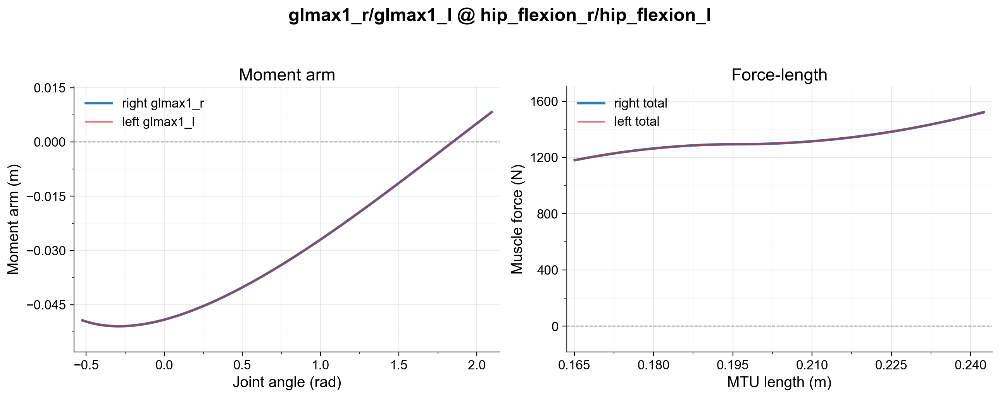

# MyoLeg

MuJoCo musculoskeletal model of the bilateral lower extremity, derived from Rajagopal et al.'s full-body gait model.

## Anatomical scope

| Property | Value |
|---|---|
| Degrees of freedom | 29 |
| Actuators (muscles) | 80 |
| Body segments | calcn_l, calcn_r, femur_l, femur_r, patella_l, patella_r, pelvis, talus_l, talus_r, tibia_l, tibia_r, toes_l, toes_r |
| Primary joints | hip_flexion, hip_adduction, hip_rotation, knee_angle, ankle_angle, subtalar_angle, mtp_angle (bilateral) |

## Reference model

- **Source:** [Rajagopal Full-Body Musculoskeletal Model](https://simtk.org/projects/full_body)
- **Paper:** Rajagopal A, Dembia C, DeMers M, Delp D, Hicks J, Delp S (2016). Full-Body Musculoskeletal Model for Muscle-Driven Simulation of Human Gait. IEEE Transactions on Biomedical Engineering. ([DOI: 10.1109/TBME.2016.2586891](https://doi.org/10.1109/TBME.2016.2586891))

## Fidelity

Example fidelity check (glmax1 left/right moment-arm and force-length plot) for symmetry and muscle jumping for lower limb. The full leg muscle check can be run with `tests/debug_muscle_leg.py`.

<!-- TODO: review (quantitative fidelity claims; reproduce with the commands below) -->
Muscle fibre lengths follow the reference model: for the 24 muscles converted directly from Rajagopal et al. (2016)
(`scripts/fit_leg_rigid_maps.py`; list in `myo_sim/build/references.py`), MuJoCo's normalised fibre
length matches the published rigid-tendon fibre length over the full joint range (`tests/test_leg_rigid_conversion.py`).
The OpenSim model is not stored here.

Passive force is calibrated to measured passive joint moments (`scripts/fit_leg_passive.py`): tendon slack length and
`fpmax` per muscle fitted to the multi-joint passive moments of [Silder et al. 2007](https://doi.org/10.1016/j.jbiomech.2006.12.017)
(20 young adults), with the medial gastrocnemius kept at the ultrasound fascicle lengths of
[Narici et al. 1996](https://doi.org/10.1113/jphysiol.1996.sp021685) and each muscle at least half its active force at the
angle of maximal voluntary strength of [Anderson et al. 2007](https://doi.org/10.1016/j.jbiomech.2007.03.022)
(`tests/test_leg_passive.py`). RMS error against Silder et al.: hip 11.0 N m, knee 8.4 N m, ankle 2.1 N m.

## Known limitations

- [ ] #64 — `myoleg` naming used inconsistently across the repository
- [ ] Endpoints (markers) below the knee joints have approximately 1 cm position differences between the converted MuJoCo and OpenSim model. This may be due to the polynomial approximation of the OpenSim lookup table for knee translation degrees of freedom.
- [ ] Vastus muscle moment arms at the knee joint have relatively large differences (same sign, a few cm). This may be caused by the dependent joint constraints at the knee and also affects knee extensor muscle force.
- [ ] Muscle forces are not identical between the converted MuJoCo and OpenSim models due to differences in muscle model definitions (stiff vs. elastic tendons). Elastic tendon support in MuJoCo is not yet implemented for this model.
- [ ] Maximal isometric strength is 1.5–3.6x human dynamometry (Anderson et al. 2007) and several torque-angle peaks are
  shifted (e.g. plantarflexion peaks near neutral instead of ~23 deg dorsiflexion). The reference model (Rajagopal2016.osim
  in OpenSim) shows the same (e.g. plantarflexion ~395 Nm vs ~137 Nm human), so this is inherited rather than a conversion
  error; an experimental calibration of strength and passive stiffness would be a separate, opt-in variant.
- [ ] Passive hip moments keep an 11 N m RMS error against Silder et al. (2007): MuJoCo's muscle has no passive-onset
  parameter independent of the active force-length curve, so slack length and `fpmax` cannot move the uni-articular hip
  muscles' passive onset to the measured angles. Two passive datasets also disagree on hamstring tightness (6 Nm, Anderson et
  al. 2007, vs ~30 Nm, Silder et al. 2007, at hip 70 deg, knee extended).
- [ ] With rigid tendons the gastrocnemius fascicle shortens about twice as fast with plantarflexion as measured in vivo
  (Narici et al. 1996), because the whole muscle-tendon length change goes to the fibre.
- [ ] Muscle moment arms in the reference OpenSim model contain sudden changes (wrapping path jumps), which required the manual adjustments described below.

## Manual adjustments

- Removed wrapping objects for glmax1_l, glmax2_l, glmax1_r, glmax2_r, psoas_l, and psoas_r to prevent wrapping path jumping. Objects removed: Gmax1_at_pelvis_l_wrap, Gmax2_at_pelvis_l_wrap, Gmax1_at_pelvis_r_wrap, Gmax2_at_pelvis_r_wrap, PS_at_brim_l_wrap, PS_at_brim_r_wrap.
- Changed wrapping object type from `cylinder` to `sphere` for iliacus_l and iliacus_r (IL_at_brim_l_wrap, IL_at_brim_r_wrap) to prevent wrapping path jumping.
- Adjusted `lmin` of gaslat_l, gaslat_r, semimem_l, and semimem_r from 0.1 to 0.05 to prevent negative muscle forces.
- Post-conversion adjustments to kinematic and dynamic behaviors, inertial properties, and joint dynamics properties.
- Contact geometries based on the [Yeadon measurement method](https://yeadon.readthedocs.io/en/latest/measurements.html#measurements), slightly adjusted to fit the MuJoCo MSK model. Contact properties were optimized for contact-rich behaviors.

## Changelog

**2026-10-31** — Passive force calibrated to measured passive joint moments (Silder et al. 2007; tendon slack length and
`fpmax` per muscle, one-sided loss, ultrasound fascicle targets and an active-strength constraint; `myo_sim/build/leg_passive.py`).
Passive knee moment at hip 70 deg / knee extended: 161 Nm after the 2026-08-02 refit, 19 Nm now (Silder mean model 30 Nm,
Anderson et al. 2007 6 Nm).

**2026-10-31** — Rigid-tendon maps (`range`, `lengthrange`) of 24 leg muscles derived directly from Rajagopal2016's
optimal fibre length, tendon slack length and pennation over the full joint range (`myo_sim/build/rigid_conversion.py`),
instead of fitting the optimal fibre length to a gait-range `lengthrange`. Fixes semimembranosus, which the 2026-08-02 refit
put at ln ~1.9 standing and ~2.9 with the hip flexed (Rajagopal: ~0.95 and ~1.65), giving a 161 Nm passive knee moment. A muscle was converted only where its fibre length moved closer to OpenSim's and its isometric force error
rose by at most 2 % of Fmax; rectus femoris, vastus lateralis and gluteus maximus 3 keep their previous maps (their
force error rises), as the 2026-08-02 analysis found. Strength (Fmax) is unchanged.

**2026-08-02** — Restored anatomical optimal fiber length (`L0`), tendon slack length (`LT`), and peak isometric force (`Fmax`) from Rajagopal2016 for 6 of the 10 muscles whose `L0` was inflated >1.2x due to an oversized `lengthrange` (`bflh`, `gasmed`, `tfl`, `glmin3`, `piri`, `semimem`, both sides), after remeasuring `lengthrange` over a physiological gait-ROM sample. `recfem`, `vasint`, `vaslat`, and `glmax3` were left unchanged because anatomical retuning increased force error against the OpenSim reference.

**2026-06-04** — Refactored model loading to use updated leg model XML; added muscle symmetry checks and contact assertion tests.

**2026-06-03** — Refactored model structure and enhanced asset management.

**myoleg_v0.56 (mj237)** — Adjusted height field; migrated to MuJoCo 2.3.7.

**myoleg_v0.53 (mj120)** — Improved collisions; added height field.

**myoleg_v0.52 (mj120)** — Removed extra body that made the torso twice as heavy; body mass is now approximately 80 kg.

**myoleg_v0.51 (mj120)** — Added new keyposes to mark convenient poses.

## MyoLeg26 (reduced 26-muscle legs + passive torso)

`myolegs26` pairs the passive anatomical torso scaffold (no arms, no torso muscles) with a reduced
26-muscle leg chain. It is structurally identical to `myolegs` apart from the muscle count and kinematic simplifications (e.g., planar joints).

### Anatomical scope

| Property | Value |
|---|---|
| Degrees of freedom | 18 (46 incl. equality-coupled moving-via-point DoFs) |
| Actuators (muscles) | 26 |
| Body segments | pelvis + legs (calcn / femur / talus / tibia / toes, L+R) + passive torso scaffold (spine, ribs, head; no arms) |
| Primary joints | hip_flexion, hip_adduction, hip_rotation, knee_angle, ankle_angle, mtp_angle (bilateral) |

### Reference & credits

Reduced from the OpenSim gait2392 / gait9dof18 lineage (Ajay Seth, based on
Delp et al. 1990; muscle strengths after Handsfield/Rajagopal, tuned by
Carmichael Ong; planar knee after Yamaguchi & Zajac 1989). Adapted for MyoLeg
by Chun Kwang Tan (sagittal-plane joints, ankle ROM, GRF foot sensors) and
extended by Calder Robbins (toes + mtp joints, EDL/FDL muscles). License:
CC-BY 3.0.

## Citation

See repository README.
